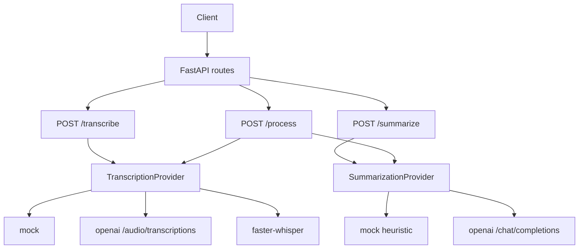

# AI Meeting / Voice Note Summarizer

[](https://github.com/maikama8/ai-meeting-summarizer/actions/workflows/ci.yml)

Meetings and voice notes usually end as audio. The useful part — what was decided, who owns the next step, and when it is due — is buried in the recording. This service turns that audio into a transcript, a short summary, and action items.

It is a portfolio project: a small FastAPI application with a clean provider boundary. The default providers run entirely offline, so the API, the tests, and Docker start with no API keys. OpenAI and a local faster-whisper model are wired in behind the same interfaces and selected with environment variables.

## Features

- `POST /transcribe` turns an upload into a transcript.
- `POST /summarize` turns a transcript into a summary, key points, and action items.
- `POST /process` runs both steps and returns the transcript plus the notes.
- Action items include an owner and a due date when the text supports them.
- Transcription and summarization sit behind provider interfaces. `mock` is the default. `openai` calls the OpenAI audio and chat APIs. `faster_whisper` runs a local model.
- Text uploads (`.txt`, `.md`, `.vtt`, `.srt`) are accepted so the pipeline can be exercised without a microphone.
- Interactive OpenAPI docs at `/docs`, a `/health` probe, and a configurable upload limit.

The offline summarizer is an English heuristic. It is deterministic and good enough to demo the contract. It is not a substitute for the OpenAI summarizer on messy real meetings.

## Tech stack

- Python 3.11+
- [FastAPI](https://fastapi.tiangolo.com/) and [Pydantic Settings](https://docs.pydantic.dev/latest/concepts/pydantic_settings/)
- [Uvicorn](https://www.uvicorn.org/)
- [HTTPX](https://www.python-httpx.org/) for the OpenAI REST calls
- [pytest](https://docs.pytest.org/) and [Ruff](https://docs.astral.sh/ruff/)
- Docker

`faster-whisper` is an optional install. It is not part of the base image or the default `requirements.txt`, because it downloads a speech model.

## Architecture



`app/main.py` builds one transcription provider and one summarization provider from the environment when the process starts. Routes depend on those objects, so tests can replace them without touching the network. `app/services/pipeline.py` is the only place that chains the two steps.

| `TRANSCRIPTION_PROVIDER` | Behavior |
| --- | --- |
| `mock` (default) | Text files are returned as the transcript. Audio files receive a bundled sample meeting, with a `notice` saying the audio was not decoded. |
| `openai` | Multipart request to `{OPENAI_BASE_URL}/audio/transcriptions` using `OPENAI_TRANSCRIPTION_MODEL` (default `whisper-1`). Requires `OPENAI_API_KEY`. |
| `faster_whisper` | Loads `faster-whisper` and transcribes on this machine. Requires `pip install faster-whisper`. |

| `SUMMARIZATION_PROVIDER` | Behavior |
| --- | --- |
| `mock` (default) | Reads a title, an `Attendees:` line, `Decision:` lines, commitments (`I will`, `we need to`, `Name should`, `please`, ...), and due dates (`2026-11-05`, `6 November 2026`, `by Friday`, `tomorrow`). |
| `openai` | Chat completion at `{OPENAI_BASE_URL}/chat/completions` using `OPENAI_SUMMARY_MODEL` (default `gpt-4o-mini`). The model is asked for JSON. Requires `OPENAI_API_KEY`. |

Choosing `openai` without a key, or `faster_whisper` without the package installed, stops the process at startup with a clear error.

## Getting started

### Local

```bash
git clone https://github.com/maikama8/ai-meeting-summarizer.git
cd ai-meeting-summarizer
python -m venv .venv
source .venv/bin/activate  # Windows: .venv\Scripts\activate
pip install -r requirements.txt
cp .env.example .env
uvicorn app.main:app --reload --host 127.0.0.1 --port 8000
```

- API: `http://127.0.0.1:8000`
- Docs: `http://127.0.0.1:8000/docs`
- Health: `http://127.0.0.1:8000/health`

Install `requirements-dev.txt` instead when you also want pytest and Ruff.

### Docker

```bash
docker compose up --build
```

The image listens on port 8000 and defaults to the mock providers. Compose reads `TRANSCRIPTION_PROVIDER`, `SUMMARIZATION_PROVIDER`, `OPENAI_API_KEY`, and the other variables from your shell or a `.env` file in this directory. An empty `.env` copied from `.env.example` is enough.

### Configuration

Settings are loaded from the environment and from a `.env` file in the working directory. Names are case-insensitive. See `.env.example` for the full list.

| Variable | Default | Purpose |
| --- | --- | --- |
| `TRANSCRIPTION_PROVIDER` | `mock` | `mock`, `openai`, or `faster_whisper` |
| `SUMMARIZATION_PROVIDER` | `mock` | `mock` or `openai` |
| `OPENAI_API_KEY` | empty | Required when either provider is `openai` |
| `OPENAI_BASE_URL` | `https://api.openai.com/v1` | API root, including compatible gateways |
| `OPENAI_TRANSCRIPTION_MODEL` | `whisper-1` | Audio model |
| `OPENAI_SUMMARY_MODEL` | `gpt-4o-mini` | Chat model |
| `OPENAI_TIMEOUT_SECONDS` | `60` | HTTP timeout |
| `FASTER_WHISPER_MODEL` | `base` | Model size passed to faster-whisper |
| `FASTER_WHISPER_DEVICE` | `cpu` | `cpu` or `cuda` |
| `FASTER_WHISPER_COMPUTE_TYPE` | `int8` | CTranslate2 compute type |
| `MAX_UPLOAD_BYTES` | `26214400` | Upload limit, 25 MiB |

Local transcription:

```bash
pip install faster-whisper
# in .env
# TRANSCRIPTION_PROVIDER=faster_whisper
```

## API

### `GET /health`

```bash
curl -s http://127.0.0.1:8000/health
```

```json
{
  "status": "ok",
  "transcription_provider": "mock",
  "summarization_provider": "mock"
}
```

`GET /` returns the same provider names plus the service version and a link to `/docs`.

### `POST /summarize`

JSON body: `transcript` (required string) and optional `language`.

```bash
curl -s -X POST http://127.0.0.1:8000/summarize \
  -H 'Content-Type: application/json' \
  -d '{"transcript":"Ada: I will send the recap by Friday."}'
```

```json
{
  "summary": "Meeting notes. 1 action item captured.",
  "key_points": [],
  "action_items": [
    {
      "description": "Send the recap by Friday",
      "owner": "Ada",
      "due_date": "Friday"
    }
  ],
  "participants": [],
  "provider": "mock"
}
```

`owner` and `due_date` are `null` when the heuristic cannot see them. A group commitment such as "We need to..." keeps a null owner on purpose.

The checked example for a full meeting is [`examples/sample_output.json`](examples/sample_output.json), produced from [`examples/sample_transcript.txt`](examples/sample_transcript.txt):

```json
{
  "summary": "Notes from Weekly product sync - 2 November 2026. Participants: Amaka Okonkwo, Chinedu Adeyemi, Fatima Bello. We are delaying the mobile release until the hotfix is verified. 5 action items captured.",
  "key_points": [
    "The support queue is up 18%.",
    "We are delaying the mobile release until the hotfix is verified."
  ],
  "action_items": [
    {
      "description": "Ship the billing hotfix before Friday",
      "owner": null,
      "due_date": "Friday"
    },
    {
      "description": "Update the invoice API by Wednesday and send the PR to Amaka",
      "owner": "Chinedu Adeyemi",
      "due_date": "Wednesday"
    },
    {
      "description": "Draft a customer note by 6 November 2026",
      "owner": null,
      "due_date": "6 November 2026"
    },
    {
      "description": "Add regression tests for the refund path",
      "owner": "Chinedu Adeyemi",
      "due_date": "2026-11-05"
    },
    {
      "description": "Schedule a follow-up with finance next Monday",
      "owner": "Fatima Bello",
      "due_date": "next Monday"
    }
  ],
  "participants": ["Amaka Okonkwo", "Chinedu Adeyemi", "Fatima Bello"],
  "provider": "mock"
}
```

`tests/test_examples.py` fails if that file drifts from a live `POST /summarize` of the sample transcript.

### `POST /transcribe`

Multipart form: `file` (required) and optional `language` (a short code such as `en`).

```bash
curl -s -X POST http://127.0.0.1:8000/transcribe \
  -F "file=@examples/sample_transcript.txt" \
  -F "language=en"
```

With the mock provider, a text file is echoed back and `notice` explains that no speech model ran. An audio file (`.wav`, `.mp3`, `.m4a`, `.mp4`, `.ogg`, `.flac`, `.webm`, and a few others) returns the bundled sample transcript and a notice that the bytes were not decoded.

### `POST /process`

Same multipart body as `/transcribe`. The response contains `filename`, `transcript`, and `summary`. `summary` is the `/summarize` object, including `action_items`.

```bash
curl -s -X POST http://127.0.0.1:8000/process \
  -F "file=@examples/sample_transcript.txt" \
  -F "language=en"
```

### Errors

| Status | When |
| --- | --- |
| 400 | Empty upload, or a `language` value longer than 16 characters |
| 413 | Upload larger than `MAX_UPLOAD_BYTES` |
| 422 | Summarize body fails validation (blank transcript, extra length) |
| 502 | The selected provider failed while calling a model or API |
| 503 | The selected provider is missing a key or dependency at request time |

## Project structure

```
ai-meeting-summarizer/
├── app/
│   ├── main.py                         # application factory
│   ├── config.py                       # pydantic-settings
│   ├── api/                            # routes, dependencies, error handlers
│   ├── schemas/meeting.py              # request and response models
│   ├── samples/sample_transcript.txt   # bundled meeting used for mock audio
│   └── services/
│       ├── factory.py                  # picks providers from settings
│       ├── pipeline.py                 # transcribe, then summarize
│       ├── transcription/              # mock, OpenAI, faster-whisper
│       └── summarization/              # mock heuristic, OpenAI chat
├── examples/
│   ├── sample_transcript.txt
│   └── sample_output.json
├── tests/
├── Dockerfile
├── docker-compose.yml
├── requirements.txt
├── requirements-dev.txt
├── pyproject.toml
└── .env.example
```

## Testing

```bash
pip install -r requirements-dev.txt
ruff check .
ruff format --check .
pytest
```

GitHub Actions (`.github/workflows/ci.yml`) runs those three commands on Python 3.12 for pushes to `main` and for pull requests.

The suite covers the HTTP contract, the offline action-item parser, provider selection, and the OpenAI adapters with a fake HTTP client. No test calls the network or downloads a speech model.

## Roadmap

- A small browser UI for upload, review, and copy-out.
- Speaker diarization, so owners are tied to voices rather than "Name:" labels.
- Markdown and PDF export of the notes.
- Saved meetings, starting with SQLite.
- Another summarizer, such as a local model through an OpenAI-compatible base URL (the base URL is already configurable).
- A webhook when a longer transcription finishes.

## Author

**Abdulrasheed Oseni** ([@maikama8](https://github.com/maikama8)) — full-stack developer and VoIP engineer in Lagos.

This repository is a public portfolio project.

## License

[MIT](LICENSE). Copyright (c) 2026 Abdulrasheed Oseni.
